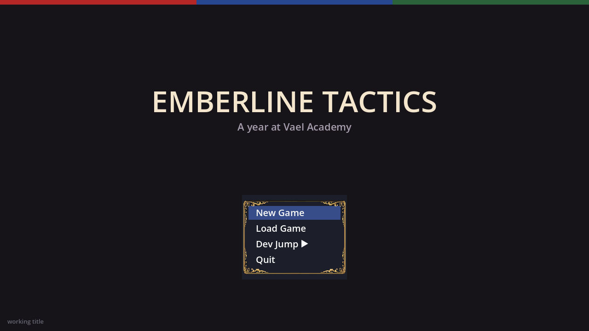
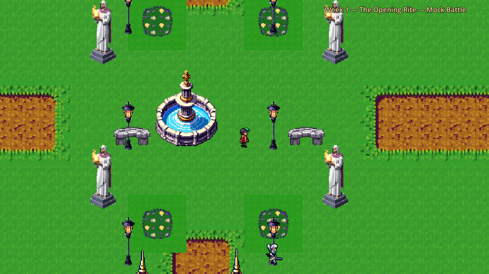
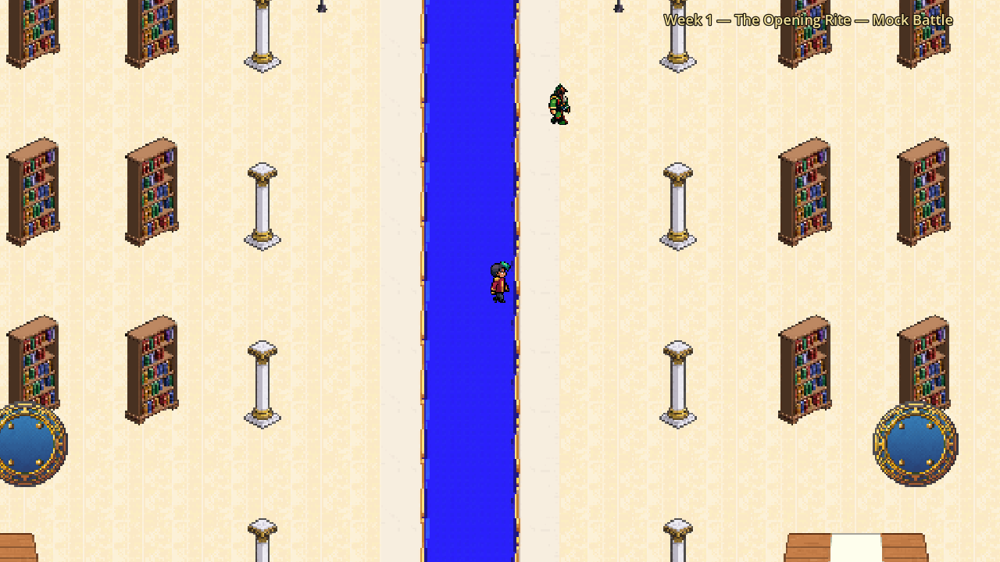
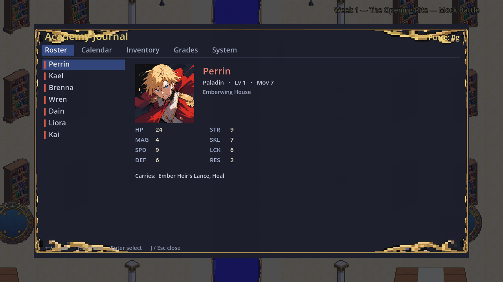
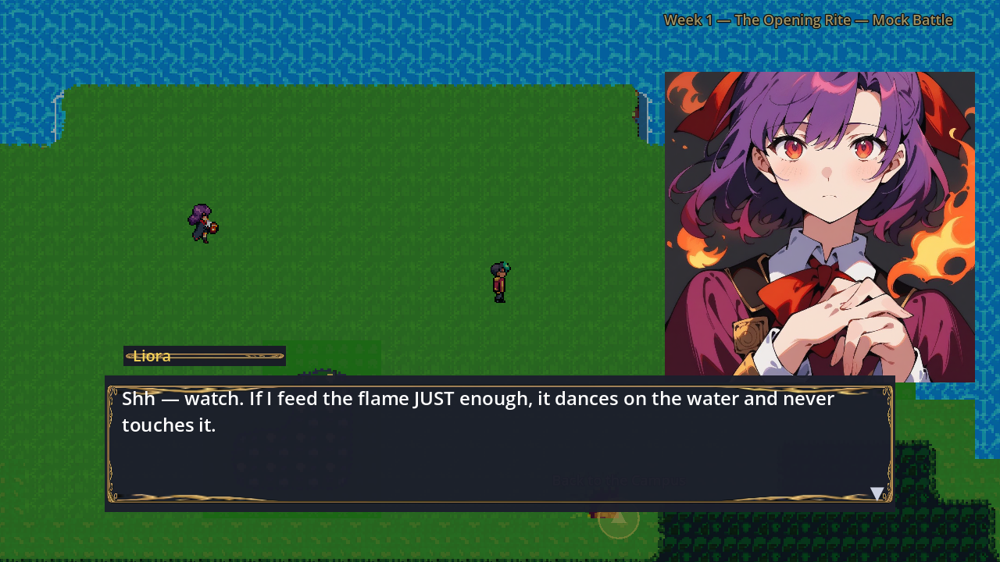
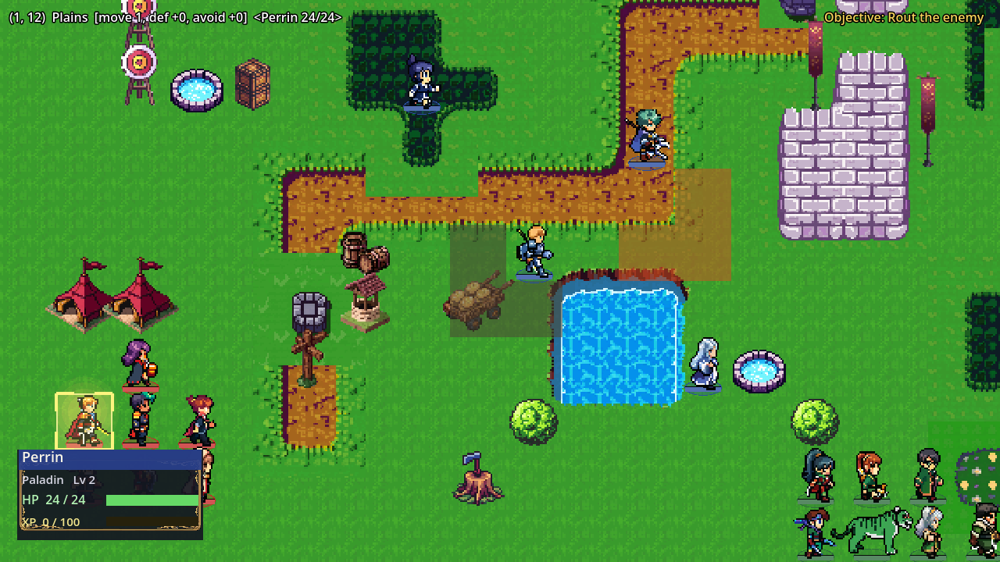
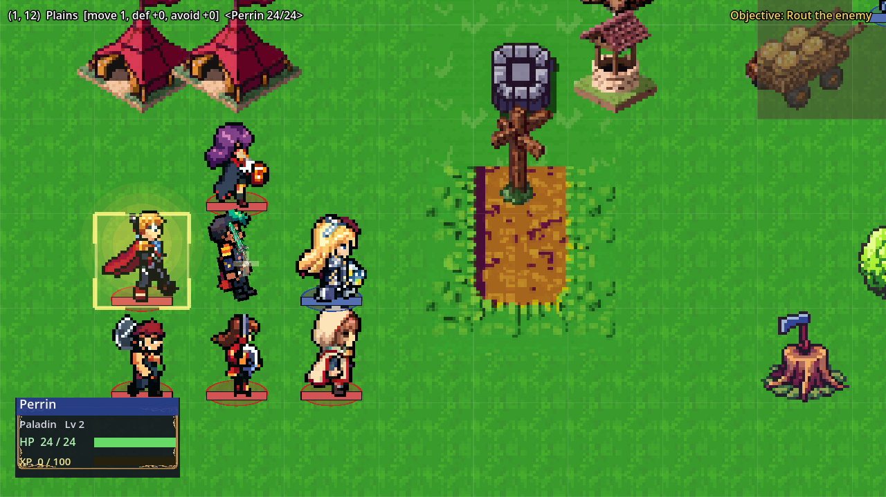
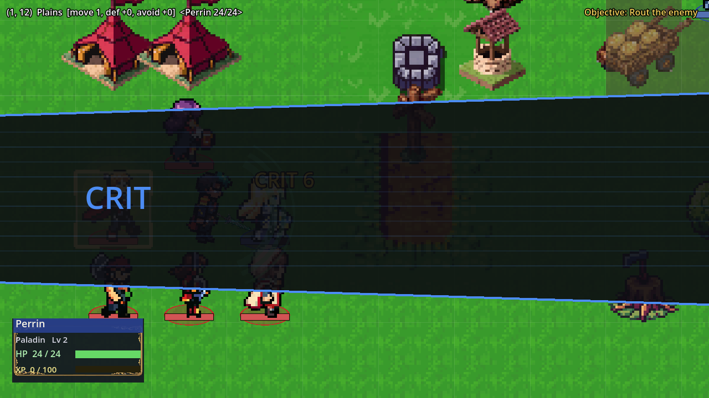
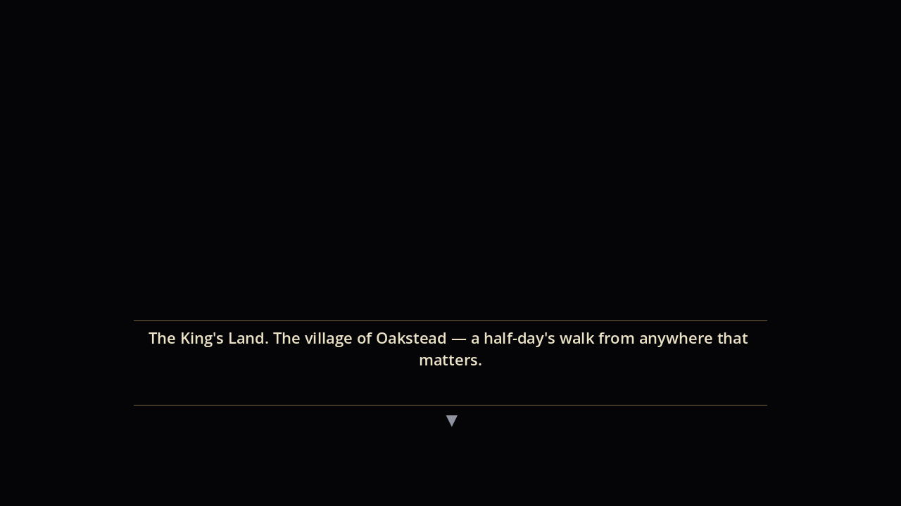
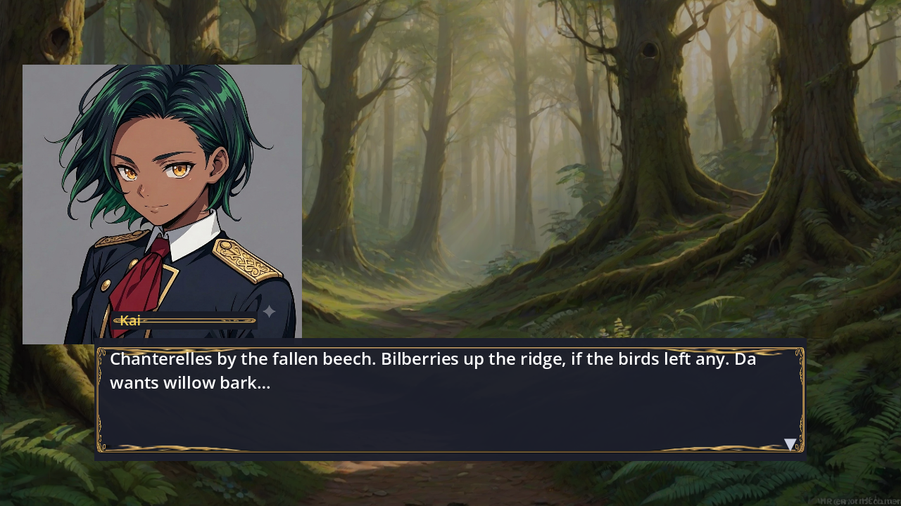

# AUDITS.md — cross-agent findings inbox

Any agent (Claude, Codex, or other) that audits the project files its findings
HERE, against a named commit. The implementing agent triages each finding into
a WO, marks the outcome, and leaves the row — this file is append-and-annotate,
never rewrite history. Rules of engagement live in `AGENTS.md`.

**How to file:** one row per finding, with the commit audited, the file:line,
and a one-line failure scenario. **How to close:** the fixer adds the WO id and
outcome. Design/content findings go to the *Deferred* table with an owner
(usually "co-write" — Neal decides story/design).

---

## Audit: Codex 5.6 sol — 2026-07-09, audited at AW-72 (496/496 green)

### Mechanical findings → fixed in AW-76 (all six CONFIRMED)

| # | Finding | Site | Outcome |
|---|---|---|---|
| 1 | Prologue victory advanced Week 1→2 via `Campaign.capture()` before Kai reaches Vael | `src/core/campaign.gd` capture() | ✅ AW-76 — victory only advances the calendar when `house_locked` (the year is underway) |
| 2 | "Rest until next week" skipped required battles unconditionally | `castle_scene.gd _rest_week` | ✅ AW-76 — resting on a BATTLE week refuses with a toast until the mission is answered |
| 3 | Journal saves wrote raw `Campaign.to_dict()`; loader requires `{"campaign": ...}` — slots looked occupied but couldn't load | `academy_journal.gd _do_save` | ✅ AW-76 — saves route through `Campaign.save_to_slot` (+ round-trip test) |
| 4 | Journal tests wrote/deleted the player's REAL slot 2 (`user://saves`) | `tests/test_academy_journal.gd` | ✅ AW-76 — tests use a per-run temp save dir |
| 5 | Battlefield grades never counted casualties (the dead leave `_units` before the headcount) | `battle_view.gd _end_battle` | ✅ AW-76 — `_fielded_at_start` snapshot at deployment, carried through save payloads |
| 6 | Semester 2 never closed — no year-end report card/ceremony | `campaign.gd advance_week` | ✅ AW-76 — both semesters close (`semester <= 2`) |

### Story/design findings → co-write agenda (Neal decides)

| Finding | Where it goes |
|---|---|
| Canon conflict: Kai carries the sword into the cave, but his parents later unwrap and gift the same sword (`CHARACTER_BIBLE_KAI.md:29` holds both) | COWRITE_PLAN §H |
| Canon conflict: plan says sword-only Kai with involuntary magic in the opening slice, but he starts with usable Crownspark | COWRITE_PLAN §H |
| Thematic risk: "belonging is built, not inherited" vs. Kai secretly having the most important bloodline — story must confront it (proposed resolution: blood opens the door; what he protects determines whether the power answers) | COWRITE_PLAN §A note / STORY_CRAFT rules |
| Route parity is mechanical: all three houses share Emberwing's `mock_battle_intro/outro.json` | COWRITE_PLAN §G (route-aware dialogue) |
| Closing Rite reuses the opening map/structure — harder, not different; no climax | Backlog (post-co-write map WO) + COWRITE_PLAN §B (W6 beat) |

### Engineering findings → backlog (real, not urgent)

| Finding | Status |
|---|---|
| Nilu roster parity: Thornrook fields an extra unit when player-chosen; rival Thornrook omits her; free-deploy/Rina-retreat rules unimplemented | Backlog — pair with the house-aware enemy spawning follow-on (AW-30 known limit) |
| Only 2 support chains vs 32 units — breadth without authored depth | Co-write §F produces the pair matrix; drafting follows |
| Kai's spell pace: weekly 4-question quizzes shouldn't ladder every school; reserve spellbooks for exams/bosses/story | Design dial — co-write §G/H |
| Enemy AI: no healer/support behavior, weapon selection, formations, chapter goals | Backlog (M8-adjacent) |
| M9 presentation debt: title identity, pixel font, settings persistence, music breadth, transitions, Dev Jump gating | Tracked in MASTER_PLAN M9 |
| `battle_view.gd` (~1,650 lines) and `castle_scene.gd` (~1,200) regrown past comfortable size | Backlog — second extraction pass before big content scale-up |
| One end-to-end integration test: Title → prologue → oath → Opening Rite → semester → Closing Rite → report card | Backlog — good candidate for the next hardening WO |
| Asset provenance review before any public release (sample-derived sprite work) | Neal's call pre-release; sources documented in HANDOFF/§10 AW-7 |

### Audit notes

- Codex audited mid-session while AW-73/74 were uncommitted in the same
  worktree and saw transient parse failures — that's the hazard the
  single-worktree rule in AGENTS.md exists to prevent. Audit against a tagged
  green commit, or use a separate `git worktree`.

---

## Audit: Codex co-write plan review — 2026-07-09, audited at AW-76 (`45a048ca`)

Baseline independently verified: **519/519 tests green**. The suite still emits
13 `wait_frames` deprecation notices plus Godot's exit-time report of two leaked
objects / one live resource; both are cleanup debt, not observed game failures.

### Session-shape finding (co-write — Neal decides)

The unlocked agenda totals **175 minutes before discussion, breaks, or wrap-up**
and asks the room to lock the year spine and villain, then draft five prologue
scenes, three pitches, 2–3 supports, and a lore batch. That is likely to reward
fast prose at the expense of the macro decisions `STORY_CRAFT.md` says must come
first.

Recommended definition of done for Friday:

| Time | Outcome |
|---|---|
| 0:00–0:10 | Rule on the sword, Crownspark, and blood/theme conflicts from §H |
| 0:10–0:50 | Lock W4–W6, the player/Kai knowledge state, and the three-clue ledger |
| 0:50–1:10 | Set only the villain dials that materially affect year one |
| 1:10–1:20 | Break |
| 1:20–2:10 | Prologue pass, prioritizing the parent reveal and transitions into/out of it |
| 2:10–2:25 | Lock each house pitch's worldview, callback, and promise; prose can follow |
| 2:25–2:45 | Lock support-pair arcs and year-one romance scope; prose can follow |
| 2:45–3:00 | Read back decisions, assign drafts, and record unresolved questions |

**Subtract from the live session:** the §G lore-copy batch and the goal of writing
2–3 complete C-ranks. Both become safer and faster once the answers and support
arcs are locked. If the room is moving unusually fast, pull one C-rank back in.

### High-value additions (co-write — Neal decides)

| # | Proposal | Why it improves the spine |
|---|---|---|
| CW-1 | Add a four-column knowledge matrix for each major beat: **player / Kai / Alaric / prince**. Lock exactly what each knows after P1, P2, W4, W5, W6, and the epilogue. | Prevents accidental spoilers, arbitrary Alaric withholding, and a villain who knows things without an acquisition beat. |
| CW-2 | Add a clue ledger for the **too-fine token / fourth-line note / palace lamps**: literal answer, plausible first reading, reveal beat, and payoff. | Enforces “no clue without an answer” and makes each promise auditable before prose multiplies it. |
| CW-3 | Make W5's agent escape the consequence of **protecting people instead of pursuing them**, not an invincible boss or post-defeat cutscene escape. The agent gets confirmation because Kai exposes Crown-light while saving someone. | Turns the theme into play, gives the prince a fair information source, and makes the escape feel earned rather than protected by plot. |
| CW-4 | Let W6 pay off the opening rite by changing its verb: the three houses begin as rivals, then must protect one another when the rite destabilizes or is sabotaged. Move the employer glimpse to the epilogue if W6 becomes crowded. | “Harder mock battle” is escalation, not culmination. Cooperation makes chosen belonging the year's mechanical and emotional answer. |
| CW-5 | Give W4–W6 one route-lens sentence per house: how Emberwing, Tidemark, and Thornrook interpret the same event, and which route character carries the key emotional beat. | Keeps the common spine while preventing Emberwing from becoming the unspoken canon route. |
| CW-6 | For every support pair, lock **C = surface misread, B = exposed wound, A = protective choice/proof, S = optional confession** before drafting any rank. Also distinguish “eventually romanceable” from “authored in year one.” | Preserves arc shape across many pairs and reconciles `CHARACTER_BIBLE_KAI.md` (“every student”) with a deliberately smaller first-year writing scope. |

### Proposed rulings on the two canon conflicts (co-write — Neal decides)

1. **Sword:** Kai has carried and used the plain blade for years, so it can open
   the cave. His parents do not give him the blade after the awakening; they
   reveal that it was found beside him and give him the **wrapping, scabbard, or
   crest** they hid with that truth. The scene keeps a physical reveal without
   teleporting the sword out of his possession.
2. **Crownspark:** separate **manifestation** from **agency**. Crown-light erupts
   involuntarily in the prologue and can appear once as a scripted rescue beat;
   the player-controlled Magic command unlocks only after an Academy teaching
   beat. This keeps the shipped spell identity while honoring the slow reveal.
3. **Blood/theme refinement:** “Blood grants access, not authority; protection
   earns trust.” The prince's blood should open some of the same doors, or Kai's
   victory still reads as superior inheritance. What the two men choose to
   protect is what separates them and what determines who can wield the whole.

### Optional trims / cautions (co-write — Neal decides)

- Do not make “Gray Prince” common gossip too early unless year one intends the
  dead-prince answer to be nearly solved; a non-royal field title preserves more
  room for the royal reveal.
- Keep W4's vision concrete enough to pay off, but avoid a generic prophecy that
  only says “green fire and a crown.” Give it one identifiable place, object, or
  human action that can later be re-read.
- Let the W6 character climax finish before the year-two villain hook. One scene
  doing rite payoff, route payoff, mystery reveal, and royal teaser will flatten
  whichever beat arrives first.

---

## Audit: Codex — 2026-10-14, AUDIT-CP-1, audited at `6e971f8f`

**Verdict:** keep CP-1's architecture, repair its presentation defects, and prove the non-pixel direction with a small live pilot before producing the cast. The game systems can survive this art change. CP-1 is useful groundwork, but its completed-status wording overstates the visible result.

**Scope and baseline:** the checkout was clean at `6e971f8fd0c84c105d511e36ab2cd02457d6bcbd`. This is the latest CP-1 commit Neal identified as Gemini's work; its 33-file diff was reviewed against its parent. Repo-wide inventory covers 22,869 tracked files, including 99 game scripts, 88 test/helper scripts, 213 data files, 22 scenes, and 16 tools. Review covered the handoff/plan, art and story bibles, campaign/roster/save boundary, combat resolver and executor, unit/castle/terrain/dialogue/UI renderers, generation tools, and representative source/live assets. Art inspection was sample-based, not a visual inspection of all 10,505 PNGs or an exhaustive audit of every code path.

**Verification:** `godot --headless -s addons/gut/gut_cmdln.gd -gdir=res://tests -ginclude_subdirs -gexit` passed **531/531 tests, 3,214 assertions, 78 scripts**, on Godot 4.7.2. Thirteen GUT deprecation notices and exit-time reports of two leaked objects / one live resource match prior audit cleanup debt. Non-headless OpenGL captures exercised the real renderers at 1280×720. Additional runtime probes verified the findings below. Evidence lives in [`assets/art_review/cp1_audit/`](assets/art_review/cp1_audit/).

### Mechanical findings — implementer to triage into a named WO

| ID | Severity | Commit | Site | Failure scenario / evidence | Outcome |
|---|---|---|---|---|---|
| CP1-1 | P1 | `6e971f8f` | `src/ui/juice_controller.gd:202`, `:212` | `tw.chain().set_parallel(true)` puts recovery tweens back into the outward step; both write the same position/scale/rotation concurrently. Ordinary FLINCH and critical STAGGER stay at home with scale 1 and rotation 0 at all eight runtime samples. Controls verify the same target moves on DODGE and on correctly chained flinch. The classifier tests pass without exercising this motion. | ✅ CP-2 — sequential outward/recovery groups; timed test asserts push, deformation, rocking and restoration; reactions awaited before counters. |
| CP1-2 | P2 | `6e971f8f` | `src/ui/combat_rig.gd:272`, `:558`, `:613` | `_power()` has no production caller; damage 1 and 20 generate identical slash items and draw through the same radius/alpha. A normal miss generates that same trail too. Crit/kill size changes and melee miss under-reach work, but the documented damage-scaled trails and miss dimming do not. | ✅ CP-2 — damage intensity and miss alpha reach slash/thrust items and rendering; regression test verifies differing payloads. |
| CP1-3 | P2 | `6e971f8f` | `src/ui/combat_rig.gd:214` | Illustrated scaling/foot alignment uses full texture height. A 128px canvas with visible pixels ending at y=112 puts the visible foot at 9.5 instead of the expected 16 (6.5 source-space pixels above the floor). Differing transparent margins or action silhouettes produce floating feet and body-size changes. The existing test uses fully opaque squares and misses this. | ✅ CP-2 — kit-wide scale, per-pose feet/hands, foot-pivot rotations; opaque-bound fallback for legacy textures; padded/crouched test verifies scale and floor alignment. |
| CP1-4 | P2, preview regression | `6e971f8f` | `src/proto/cutout_signatures.gd:57` | The signature showcase calls `setup()` and `set_weapon()` but never `set_fx_source()` / `set_spell_meta()`. After removal of the unit/id FX tables, it retains a default profile: Rina fires an arrow instead of her beam and signature melee colors use the default steel tint. Live `JuiceController` does supply the source; `cutout_magic.gd` uses the compatibility shim. | ✅ CP-2 — signature showcase now resolves the equipped signature FX through `set_spell_meta()`; other direct callers checked for prior behavior. |

The probes and both control animations are retained in [`runtime-probe.txt`](assets/art_review/cp1_audit/runtime-probe.txt) and [`probe.gd`](assets/art_review/cp1_audit/probe.gd). Run the latter with `godot --headless -s res://assets/art_review/cp1_audit/probe.gd`. They exercise existing production code without changing it. These are cosmetic failures; this review found no CP-1 change to combat formulas, AI, progression, or the save schema.

### CP-1 acceptance assessment

**CP-5 implementation follow-up (2026-10-15, from green `1ecc35d3`):** The first clothed 3D substitute failed Neal's likeness review and was removed from runtime. Neal explicitly redirected to existing Kai art with the authored animation. A new isolated art-transfer scene preserves original head/torso/hand/sword pixels and reuses clean cloth assets, driven by actual UAL joints rather than CP-3's rejected procedural gait. Three tests verify source-driven painted support contact, unchanged original head texture/geometry/scale and safe comparison/real-turn fallback. Full suite 545/545, 3,379 assertions. **This does not establish visual approval**: deformations/joins, cloth, likeness in motion and directional views remain review work. Generic model evidence is disabled in `assets/art_review/cp5_model_rejected/`; current proof is `assets/art_review/cp5_art_transfer/`. CP-4's source/accepted code and CP-2 attacks are unchanged. This is an implementation record, not an independent audit.

**CP-5 review correction follow-up (2026-10-15, from green `f0052e71`):** Neal called the existing-art preview "a pretty good improvement," then flagged a backward sword and knee-pad appearance. Replaced only the carrying forearm/hand/weapon layer with one targeted built-in ImageGen asset using original Kai and the approved CP-4 grip as references. Blade, guard, fist and pommel remain rigidly together; original head/torso pixels and source gait are unchanged. Navy trouser mesh now crosses the knee continuously and calf boots begin below it. A fourth regression test samples actual painted steel/green hilt pixels and checks forward/down world direction in both facings. Full suite **546/546, 3,385 assertions**; corrected capture and logs: `assets/art_review/cp5_art_transfer/corrections_v2/`. Raw transparent image, prompt and reference/output hashes: `assets/source/kai_motion_corrections/`. The two fixes await visual review; no claim of finished walk/cast approval. This remains the same CP-5 work order and an implementation record, not an independent audit.

**CP-5 ankle follow-up (2026-10-15, from green `dccc51d4`):** Neal said "looking better" but reported the foot detaching during steps. Rendered reproduction confirms the gap; the toe-anchored painting's cuff differs from the source ankle by up to 11.49 screen pixels. Only the boot shaft endpoint now follows the actual painted cuff, preserving source-driven toe/foot motion and the accepted head/torso, sword and trouser refinements. A fifth focused test checks opaque painted cuff/shaft overlap through 960 Idle/Normal/Formal poses (both legs/facings); old walks have zero overlap in failing poses, repaired walk probes retain at least 47 sampled pixels. **547/547 tests, 3,386 assertions**. Repro scripts, before image, close-up cycles in both directions and logs: `assets/art_review/cp5_art_transfer/ankle_v3/`. No new textures/image calls, source animation edits, CP-4 changes, campaign/math/save/canon changes or other WO. Repaired motion remains for Neal's visual review; implementation record only.

**CP-4 implementation follow-up (2026-10-15, from green `0bf2c178`):** Neal accepted the authored grey human walk and turn, replacing the rejected detached-parts foundation. Quaternius CC0 source rig/motion and KayKit's CC0 sword are preserved with licenses, pinned source revision and hashes in `assets/source/authored_motion/README.md`. The same skeleton rotates without reflection/head replacement; source-matched travel, planted toes, finger-only stance preservation and hand-local sword direction are exercised by four new tests. Blade/guard direction and carrying wrist corrected after Neal's backward-sword report; **Neal approved the corrected grip on October 15 ("looks good")**. Knight visual rejected/removed. Full suite **542/542, 3,325 assertions**; current clip, screenshots, capture harness and logs in `assets/art_review/cp4_motion/`. This is an implementation follow-up, not an independent audit of its own uncommitted tree. Kai's finished model/style, clothing, equipment attacks and production performance remain open. No canon or gameplay migration; accepted CP-2 attacks remain intact.

**CP-3 rejected experiment / next foundation (2026-10-14, based on green `115ae9c4`):** Neal rejected the detached-art procedural rig and its revised pass: walking still looks injured/awkward and the sword grip backward. Four Gemini image calls supplied isolated parts and a closed grip; pure stance math and native mesh joints passed mechanical checks, but visual acceptance failed. Experimental runtime was removed and CP-2 restored, with 538/538 tests green. Evidence and disabled experiment are in `assets/art_review/cp3_walk/`. Natural walking and weapon carry remain OPEN. Recommendation for Neal to consider: one properly rigged character with authored/mocap animations, cel-shaded and optionally rendered as sprites for the existing 2D game. Do not interpret this recommendation as authority to rewrite the style/canon or migrate gameplay to 3D. Prove movement and grip with an existing coherent model/motion before dressing it as Kai. No more procedural cutout retries without a materially different animation foundation.

**CP-2 motion review from Neal (follow-up to green `7fd8af8e` / `114d1d55`):** attack/casting refinements look better; walking still does not look natural, and subsequent generation/flattened-image limb experiments worsened it. Those experiments were reverted. Gait remains an open art issue, not resolved by passing mechanics tests. Retained follow-up repairs: distance-paced playback, matching torso registration between walking and idle, and a mark-only facing correction for the return walk so the Crown-mark does not reflect to the right brow. Neal caught the separate head changing size; that replacement was removed. Both directions now preserve the exact original head drawing and scale, verified by a rendered head-bounds check. Neal explicitly places it over Kai's anatomical left brow; that instruction is recorded in `CHARACTER_BIBLE_KAI.md`. A proper authored cycle or genuinely separated animation artwork is required for the next walk pass.

| Part | What actually works | What remains |
|---|---|---|
| Strike outcomes | Full result reaches the rig; crit anticipation, kill follow-through, melee miss under-reach, impact HP application | Damage/miss trail rendering (CP1-2); current tests mainly inspect flags |
| Target reactions | Pure classification; dodge and lethal knockback paths | Flinch/stagger are cancelled (CP1-1); reaction tests do not assert timed motion |
| Data-driven FX | Unit/weapon fields; weapon overrides; natural-weapon hiding; live controller integration | Signature showcase migration (CP1-4); school→style defaults and bow beam colors still contain code choices, so "fully data-driven" needs qualification |
| Three-pose hook | Optional texture loading, idle/action swapping, linear filtering, missing-pose fallback | Zero `idle.png`, `action.png`, or `parry_hit.png` assets at the new live convention; no production call selecting `PARRY_HIT`; actual foot anchors (CP1-3); persistent map and campus illustrated actors |

An illustrated attacker would currently replace a pixel actor only during its strike, then return to the pixel actor. The defender stays a `Unit`, and `_react_target()` never creates its illustrated rig. This is a hook awaiting integration, not evidence that the proposed art direction has been tested in-game. Also, one baked-weapon pose set per character cannot faithfully show every equipped weapon/spell without an explicit pose/weapon policy.

### Visual walkthrough — current renderer evidence

Scenes were entered through a temporary capture harness using production scene/room/dialogue methods. The combat capture deliberately stages Kai beside Serra and supplies a resolved six-damage critical strike; it verifies presentation, not an organic player/RNG exchange. No saved campaign was loaded, overwritten, or deleted. Captures are current evidence, not screenshots inherited from older sessions.

| Step | Surface and health | Finding / implication |
|---|---|---|
| 1 | [Title](assets/art_review/cp1_audit/01-title.png) — renders | Clear menu; presentation is a placeholder identity with a pixel ornament frame. |
| 2 | [Campus](assets/art_review/cp1_audit/02-campus.png) — renders | Walkable spatial foundation works; broad bright grass and repeated props dominate. A new character alone will not establish a new environment style. |
| 3 | [Library](assets/art_review/cp1_audit/03-library.png) — renders | Furnished scrollable room, but repeated shelves/columns and bright carpet are visually uniform. Paint architectural grouping, depth and warm pools of light into a pilot room. |
| 4 | [Journal](assets/art_review/cp1_audit/04-journal.png) — renders | Useful roster/system structure; its nearest-filtered portrait and ornate pixel corners clash with the proposed illustrated register. Corner ornaments overlap heading/footer text. |
| 5 | [Liora dialogue at waterside](assets/art_review/cp1_audit/05-dialogue.png) — renders | Expressive large portrait carries the scene; the baked rectangular image background interrupts the world and the decorative nameplate competes with the name. |
| 6 | [Mock Battle overview](assets/art_review/cp1_audit/06-battle.png) — renders | Terrain, selection, houses and HP communicate the tactics layer. World and actors remain entirely pixel-based; subdued painted terrain must preserve this readability. |
| 7 | [Critical wind-up](assets/art_review/cp1_audit/07-combat-windup.png) — renders | Camera push and actor anticipation work; close zoom magnifies the old pixel assets. |
| 8 | [Critical impact](assets/art_review/cp1_audit/08-combat-impact.png) — renders, obscured | The wide opaque CRIT band hides much of the actual contact. A smaller character/weapon cut-in would let the impact remain visible. |
| 9 | [VN opening](assets/art_review/cp1_audit/09-vn-opening.png) — renders | Black opening and gold-rule narration are intentional, readable, and a promising restrained treatment. |
| 10 | [Painted forest VN](assets/art_review/cp1_audit/10-painted-vn.png) — renders | The strongest existing example of the new direction: warm painterly environment plus illustrated character. Gray portrait rectangle and pixel frame still weaken the composite. |

These captures support visible legibility/overlap findings. Keyboard focus, reduced-motion controls, contrast across every scene and end-to-end accessibility were not comprehensively tested. No full new-game/year playthrough or full-cast animation review was performed.

Captured screens in walkthrough order

### Deferred art/design proposals — owner: Neal

| ID | Proposal | Grounding / decision needed |
|---|---|---|
| ART-CP-1 | Explore an **illustrated fantasy academy**: clean linework and readable cel-shaded characters against softly painted architecture/environments, with restrained depth/parallax and expressive pose-based combat. | Existing 1024px portraits and seven painted VN backdrops are reusable anchors. Persona/Expedition references can inform timing, composition and lighting; literal 3D/photorealism is not required. Proposed style, not approved canon. |
| ART-CP-2 | Preserve the established tactical grid/projection for the first pilot; make the appearance through painted terrain/modules, actors and lighting. | Combat, collision, pathfinding and saves already work. A new projection or 3D pipeline would add a separate migration without answering whether the illustrated look feels good. |
| ART-CP-3 | Start with **Kai + one opponent + one painted room/battle patch + dialogue/journal chrome**, using the existing portraits as identity references. Include a short genuine walk cycle or limited limb rig; three combat poses can establish a prototype. | `STYLE_BIBLE.md:156` records Neal previously rejecting static sliding standees. High resolution alone does not solve that motion problem. Require consistent body scale, feet/hand anchors, transparency, facing/asymmetry and equipped-weapon handling before generating more characters. |
| ART-CP-4 | Use academy manuscript/seal styling for the UI: fine gold rules, navy/ink panels, clean typography, house-colored accents and ample space. Keep dramatic geometry for crits. | Current pixel ornaments obscure text in journal/nameplates; the narrator's gold-rule treatment already fits the proposed world. Test the same art on dialogue, journal and combat overlays. |
| ART-CP-5 | Build the visual mood from belonging: warm inhabited rooms, familiar objects, shared tables and lit windows; emerald Ward, violet Claim and gold hearthlight remain meaningful. | WORLD/ACADEMY/CAMPAIGN and character bibles own the tone and symbols. Preserve house crimson/gold, blue/silver and green/bronze without reducing characters to palette swaps. No story changes proposed. |
| ART-CP-6 | Reconcile the new art brief with historical art prescriptions after the pilot review. | MASTER_PLAN §8, STYLE_BIBLE and UITheme still describe pixel rules; HANDOFF/CP-1 describe illustrated combat. Neal's current instruction authorizes non-pixel exploration, but exact style and production pipeline are not locked. |

**Proposed pilot review gate:** Neal can watch Kai idle, actually walk, face targets and attack/cast; both combatants stay consistently illustrated through idle→attack→hit/miss→recovery, feet stay planted and damage lands at impact. Show ordinary hit, crit, miss and defeat on a readable painted patch; show the same character in a painted academy room, dialogue and journal. Keep silhouettes/terrain/ranges legible at overview and close zoom. Approve the moving in-engine result before batch production; then resume the game from the current systems/canon state.

**Where gameplay was left:** AW-79 still needs sealed-door/sanctum selection and music when tracks arrive. The year-one story/support work remains co-written with Neal; the calendar, house routes, activities, inventory, grading and mid-battle saves already exist. Their prior backlog remains valid after the art pilot. No gameplay work order or new art production was implemented during this audit.

## CP-9 implementation / optional active defense — 2026-10-15

Baseline named green commit: **f6736cc0 (CP-8)**. Implementer's record, not an
independent audit. Neal approves CP-8 as the visual/game-flow baseline and
authorizes the small optional dodge/block trial. No production combat adoption.

- **Scope:** dedicated Title Dev Jump / `active_defense_pilot.tscn`, Kai versus
  one incoming Serra thrust. Reuses original whole art, CP-6/7 player, CP-8
  sounds/FX and real native resolver first strike (11 damage). Campaign and
  progression untouched; no counters re-used after defense alters damage.
- **Provisional mechanics:** first attempt only; dodge takes0, block takes
  ceil(11×0.5)=6, failed/unused defense takes11. Block has wider timing because
  it protects less; the previously proposed tighter block would be dominated
  by the easier full dodge. Normal/wide profiles, visual meter/cue sound,
  offset feedback, keyboard/buttons and auto-block assist. Config is data.
- **Correct order:** input evaluated before commitment; the pending strike is
  finalized, then inherited contact applies HP once. Original native result
  unchanged. Actual dodge clears the blade by >75px before contact; block uses
  whole guard/recoil/metal flash. Timing measures anticipation, not a last-frame
  parry at contact. Final campaign forecast/counter semantics remain unapproved.
- **Validation:** new focused suite **3/3, 129 assertions** covers boundaries,
  damage rounding, spam, native misses, low/high-FPS assist, real input/contact,
  no stale counters and unchanged RNG/XP/uses/Campaign. Real Title route + Esc
  at impact checked separately, including time-scale restoration and deferred
  cleanup. Final logs/capture: `assets/art_review/cp9_defense/`.
- **Regression repair:** full-suite timing exposed CP-8's asynchronous test
  dialogue driver waking after its view was freed, falsely failing the following
  CP-7 test. Added an instance-validity guard to that test helper; no production
  combat/dialogue behavior changed. Final suite: **560/560 tests, 3,808 assertions,
  85 scripts, 148.221s**. Inherited13 deprecations/two ObjectDB/one resource exit
  reports remain; no new runtime errors in final runs.
- **Evidence / cost:** native 1152×648/60fps, 22.32s sound-on movie shows dodge,
  block, early failure, no-input and assist. Anatomy/silhouettes, physical evade,
  HP, UI and map return visually inspected. Three original local synthesized
  cues; no third-party import, image/API generation or spend. Existing art/FX
  credits preserved. Reused guard art is not a new drawn parry. Stop for Neal's
  feel review; no campaign or roster rollout.

## CP-8 implementation / real encounter integration — 2026-10-15

Baseline named green commit: **b8d927eb (CP-7)**. Implementer's record, not an
independent audit. Neal approved proceeding with pixel world / illustrated
battles, requested battle sounds and raised optional timed dodge/block.

- **Integration:** existing Emberwing Mock Battle scene opts in. The production
  executor passes its single native result into the CP-6/7 player; actual HP
  changes at contact, without another HP replay on return. Defeat/removal,
  one-use-per-combat durability, XP/level-up RNG, quotes/yield/outro and chapter
  results remain in their existing executor/view flow. Only approved unpromoted
  player-Kai/enemy-Serra kits qualify, including enemy initiation; unsupported
  teams/designs/weapons/matchups retain their existing presentation.
- **Audio:** five original locally synthesized sweeteners, data-driven cue map,
  existing AudioManager volume/mute/pool/cache and hit/crit/miss. No third-party
  imports/generation calls/spend; generator/provenance in
  `assets/source/combat_audio/`. Gemini/Lyria music direction recorded; no music
  generation/API access claim. Optional active defense is parked as a separate
  proposal, not cosmetic input layered over already-resolved hit damage.
- **Evidence:** `assets/art_review/cp8_integration/` has native 1152×648/60fps,
  31.95s sound-on movie, stills, production replay/interactive rehearsal scripts,
  logs and exact fixture changes. Actual menu→forecast→boss quote→combat→map,
  magic, level-up, yield/outro and Victory captured. Normal scene deployment/
  content unchanged. Existing CP-2/4/5/A-B evidence preserved.
- **Checks:** **557/557 tests, 3,679 assertions, 84 scripts, 135.057s**. New
  production tests **4/4, 75 assertions, 20.25s** cover live result/RNG/contact,
  real input, routing gates, counters/magic, uses, XP/level-up rolls, real
  quote/yield/outro input, victory/campaign capture and non-lethal defeat.
  Inherited 13 deprecations/two ObjectDB/one resource exit reports remain.
- **Review limits:** kneeling Serra has no lance and the small pose set is not
  a full drawn fall/broad slash; bright chapter heading contrast remains UI
  polish. New sound layers await Neal's listening review. Next: review full
  flow, then separate optional active-defense prototype before roster expansion.

## CP-7 implementation / Neal's approval — 2026-10-15

Baseline named green commit: **6394aef2 (CP-6)**. Implementer's record,
not an independent audit. Neal approves illustrated B, its color/magic pass
and removal of illustrated walking; pixel world/tactics stays selected.

- **Reported defect:** Serra appears to go down before being hit. Actual HP
  order was correct, but the inherited lethal reaction snapped to the kneeling
  defeat pose at contact, so hit-stop froze an already-collapsed figure.
- **CP-7 fix:** B's lethal reaction uses upright hit/recoil + 0.16s hold after
  hit-stop, then defeat knockback/fade. Reuses HitReaction classification;
  actual contact HP, native results, full counter order and anatomy unchanged.
- **Evidence:** native 1152×648/60fps movie and stills in
  `assets/art_review/cp7_defeat/`. Ordinary/critical lethal contact precedes
  collapse by 24 rendered frames (0.4s including hit-stop). Upright impact and
  later collapse visually inspected. Kneeling art omits Serra's lance; remains
  an explicit still-art limitation. No generated art or import/spend.
- **Verification:** **553/553 tests, 3,604 assertions, 83 scripts, 110.828s**.
  New native ordinary/critical timing regression: 1/1, 32 assertions. Existing
  CP-6 replay parity, miss, real tactical input/RNG and campaign checks green.
  Inherited 13 deprecations/two ObjectDB/one resource exit reports remain.
- **Next proposed scope:** one supported existing real Kai/Serra encounter
  integration, preserving executor progression/weapon uses/yield/map return
  and existing unsupported-unit presentation policy. No roster production.

## CP-6 implementation / A-B review record — 2026-10-15

Baseline named green commit: **32cf058c (CP-5)**. This is the implementer's
record and Neal's comparative review, not an independent audit of itself.
One WO was revised while uncommitted: initial illustrated-hybrid brief →
PixelLab A versus illustrated B evaluation → Neal prefers B and requests
stronger color/magic. No second WO or silent roster rollout.

Reused: unchanged CombatResolver/StrikeResult/CombatForecast/CombatRNG,
HitReaction/CombatFxProfile, BattleView pixel map/path/menus, CP-2 whole art,
and PixelLab's existing chained battle kits/player. One JuiceController
factory hook preserves its default rig and allows B's timing subclass.
CP-3 procedural anatomy is absent; CP-4/5 and CP-2 originals are preserved.

| Finding | Evidence / disposition |
|---|---|
| Comparative visual preference | Neal: **"the 2d version is definitely better than the pixel version. just not as colorful or magical looking as the pixel art."** Prefer B's illustrated actors; borrow A's saturation/elemental expression through HD effects. |
| Initial B too dim / desaturated | Final pass restores courtyard warmth, tinted emerald blade light, gather motes, larger Crown bolt and colored impact. Reduced blown-out face flash. New color pass remains for Neal's review. |
| A has useful motion but older identity / spell limitations | Existing 9-frame wind/strike/crit sequences and animated reactions are coherent; four seams are pixel-identical. Older outfit/headband/armor differ from illustrated references; duplicated weapon/afterimage shapes remain in some frames. A's sword gesture for magic is explicitly a placeholder. No new generation or per-frame cleanup. |
| B's real art limits | Small whole-pose set supports the shown thrusts/Crown-light. No broad slash/draw/independent recovery or unseen directional view; other weapon/cast kits need approved stills. Do not turn those gaps into procedural anatomy fixes. |
| Cost evidence | 0 new PixelLab, Gemini or ImageGen requests; 0 new pixel cleanup frames. Existing subscription outputs reused. No newly measured per-character yield, current account balance, plan price or roster ROI. |
| Licenses | Five HD Combat/Spell FX Free sheets (CC BY 4.0), unchanged creator players, two Kenney textures (CC0); hashes/license/adaptation record and in-engine Credits. VFX 2D/Foozle evaluated, not imported. |
| Mechanics / regression | **552/552 tests, 3,572 assertions; focused 5/5, 186 assertions.** All five native A/B cases match complete results and HP; checks cover contact order, pre-contact miss, actual tactical input, unchanged live RNG consumption/campaign and filtering. Tests are not visual approval. |

Native-resolution GPU evidence, 62.32s A/B reel, 26.63s final B reel (audio),
screenshots, source hashes, reusable-pipeline notes, caveats and reproduction:
`assets/art_review/cp6_hybrid/`. Recommended path: illustrated battle actors,
pixel world/tactics, Gemini still art and shared Godot timing/HD FX; retain
PixelLab as the world pipeline and battle reference/fallback. Stop at this
slice for review. No combat formulas, RNG roll order, progression, saves or
canon changed. Inherited 13 deprecations and exit cleanup reports remain.
